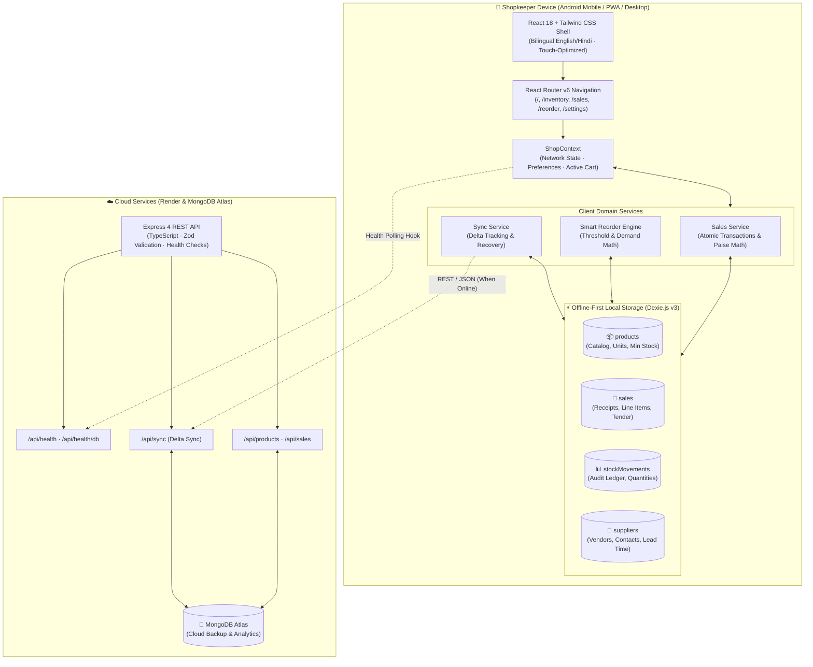

<div align="center">


### Empowering 13M+ neighborhood Indian kirana stores with offline-resilient inventory, rapid counter billing, and predictive wholesale reordering

[](https://react.dev)
[](https://www.typescriptlang.org)
[](https://tailwindcss.com)
[-4E9F3D?style=for-the-badge&logo=dexie&logoColor=white)](https://dexie.org)
[](https://vite-pwa-org.netlify.app)
[](https://expressjs.com)
[](https://zod.dev)
[](https://www.mongodb.com/atlas)
[-729B1B?style=for-the-badge&logo=vitest&logoColor=white)](https://vitest.dev)
[](https://mlh.io)
[](LICENSE)

</div>

---

## 🌟 Executive Summary

**KiranaSathi (किराना साथी)** is an **offline-first, mobile-first inventory management, rapid counter billing, and predictive reorder intelligence system** purpose-built for India's 13+ million micro-retailers (*kirana dukandar*). 

Traditional enterprise retail software fails at Indian neighborhood counters: it requires uninterrupted broadband, assumes desktop monitors, imposes clunky keyboard navigation, and lacks bilingual accessibility. KiranaSathi fundamentally rethinks counter software from the shopkeeper's perspective:

- 📶 **100% Offline-First Architecture**: Powered by **Dexie.js (IndexedDB Schema v3)** running in-browser. All stock updates, catalog additions, quick sales, and reorders execute locally with zero network latency—even when the shop experiences complete internet blackouts.
- 📱 **Mobile-First Counter Ergonomics**: Designed for single-thumb Android smartphone usage. Features touch targets of $\ge 48\text{px}$, glare-resistant high-contrast theme (`#15803D` / `#F8FAF7`), sticky counter basket drawer, and lightning-fast product search with React `useDeferredValue`.
- ⚡ **Atomic Billing & Integer Paise Precision**: High-speed counter billing using integer-safe paise math (`Math.round(rupees * 100)`) preventing floating-point drift, with concurrent transaction locks and automatic stock rollback on insufficient inventory.
- 🧠 **Deterministic Smart Reorder Intelligence**: Dual-mode reorder calculation engine (Safety Threshold mode & 14-day Sales-Aware Demand mode) calculating exact distributor order quantities, lead-time buffers, and unit-specific rounding (`Math.ceil` for packets/pieces, 2-decimal floats for kg/litre).
- 📲 **1-Tap Wholesale Supplier Management & WhatsApp Dispatch**: Map items to local wholesale distributors, auto-generate consolidated purchase orders grouped by supplier, and dispatch formatted Hindi/English reorder messages directly to WhatsApp with one click.
- 🔄 **Cloud Synchronization & Resilience**: Graceful background delta synchronization with an Express + TypeScript + MongoDB Atlas backend when network connectivity is available, protected by boot-time Zod schema validation.
- 🇮🇳 **True Bilingual Accessibility**: Instant one-tap switching between English and Hindi Devanagari labels (*होम*, *स्टॉक*, *बिक्री*, *ऑर्डर*, *सेटिंग्स*) across every screen.

---

## 🚀 Live Deployments & Application URLs

| Component | Target Platform | URL / Endpoint | Status |
| :--- | :--- | :--- | :--- |
| **Frontend PWA** | Vercel Edge | [https://kiranasathi.vercel.app](https://kiranasathi.vercel.app) *(or local [http://localhost:5173](http://localhost:5173))* |  |
| **Backend REST API** | Render Cloud | `https://kiranasathi-backend.onrender.com/api` *(or local [http://localhost:5000/api](http://localhost:5000/api))* |  |
| **Backend Health Check** | Render Cloud | `https://kiranasathi-backend.onrender.com/api/health` |  |
| **Database Ping Check** | Render Cloud | `https://kiranasathi-backend.onrender.com/api/health/db` |  |

---

## 🛠️ Complete Tech Stack

### 1. Frontend Architecture (apps/frontend)

| Technology | Version | Purpose & Architectural Role |
| :--- | :--- | :--- |
| **React** | `^18.3.1` | Concurrent UI framework with state hooks, deferred values, and responsive layouts |
| **Vite** | `^6.1.0` | Next-generation frontend build tooling with instant HMR and optimized chunking |
| **TypeScript** | `^5.7.3` | End-to-end static type enforcement across state, models, events, and API payloads |
| **Tailwind CSS** | `^3.4.17` | Utility-first styling with custom Kirana green color palette and accessible contrast |
| **Dexie.js** | `^4.0.11` | High-performance IndexedDB wrapper powering offline client-side persistence |
| **vite-plugin-pwa** | `^0.21.1` | Progressive Web App generator with Workbox service worker caching for full offline capability |
| **React Router DOM** | `^6.28.2` | Client-side routing with clean layout wrappers and active tab navigation |
| **Lucide React** | `^0.475.0` | Lightweight, crisp vector iconography for intuitive touch counter navigation |
| **Vitest** | `^3.0.6` | Modern unit and integration test runner for React components and business logic |
| **fake-indexeddb** | `^6.2.6` | In-memory IndexedDB mock enabling zero-browser offline test execution |

### 2. Backend Architecture (apps/backend)

| Technology | Version | Purpose & Architectural Role |
| :--- | :--- | :--- |
| **Node.js** | `>=18.0.0` | Scalable JavaScript runtime environment (Tested on Node `v22.x`) |
| **Express** | `^4.21.2` | Lightweight HTTP web server handling REST endpoints and synchronization |
| **TypeScript** | `^5.7.3` | Strongly-typed backend service models, middlewares, and route handlers |
| **Zod** | `^3.24.2` | Runtime schema validation for server environment variables and data payloads |
| **Mongoose** | `^9.11.3` | MongoDB object modeling supporting hybrid local/cloud synchronization |
| **CORS** | `^2.8.5` | Dynamic cross-origin resource sharing supporting local dev and Vercel domains |
| **tsx** | `^4.19.3` | TypeScript execute engine with watch mode for rapid server development |
| **Supertest** | `^7.0.0` | Programmatic HTTP endpoint assertion library for automated health testing |

---

## 🏗️ System Architecture



---

## 📂 Repository Layout

```text
KiranaSaathi-GDG-HACKFEST-MLH/
├── apps/
│   ├── frontend/                         # React 18 + Vite + TypeScript PWA
│   │   ├── public/
│   │   │   ├── icons/                    # High-res PWA application icons
│   │   │   └── manifest.webmanifest      # Progressive Web App manifest
│   │   ├── src/
│   │   │   ├── components/
│   │   │   │   ├── layout/               # AppLayout, Navbar, BottomNav
│   │   │   │   ├── products/             # ProductCardPlaceholder
│   │   │   │   └── ui/                   # Button, Badge, reusable UI primitives
│   │   │   ├── context/
│   │   │   │   └── ShopContext.tsx       # Global shop state, cart, & sync status
│   │   │   ├── data/
│   │   │   │   └── mockProducts.ts       # Comprehensive Indian kirana seed catalog
│   │   │   ├── db/
│   │   │   │   └── index.ts              # Dexie.js v3 IndexedDB database schema
│   │   │   ├── features/
│   │   │   │   ├── assistant/            # Conversational AI assistant module
│   │   │   │   ├── inventory/            # AddProductModal & inventory components
│   │   │   │   ├── reorder/              # Reorder tabs & supplier components
│   │   │   │   └── sales/                # Fast counter billing components
│   │   │   ├── hooks/
│   │   │   │   ├── useBackendHealth.ts   # Live server health monitoring hook
│   │   │   │   └── useNetworkStatus.ts   # Online/offline browser connectivity hook
│   │   │   ├── i18n/
│   │   │   │   └── index.ts              # English / Hindi Devanagari dictionary
│   │   │   ├── pages/                    # 6 Top-level application pages
│   │   │   │   ├── HomePage.tsx          # Shop overview, today's metrics & alerts
│   │   │   │   ├── InventoryPage.tsx     # Full catalog, search, and stock adjustment
│   │   │   │   ├── SalesPage.tsx         # Quick billing counter & mobile cart
│   │   │   │   ├── ReorderPage.tsx       # Smart reorder lists & WhatsApp export
│   │   │   │   ├── SettingsPage.tsx      # Shop profile, language & DB reset
│   │   │   │   └── WelcomePage.tsx       # Phase 0 onboarding & system health
│   │   │   ├── services/
│   │   │   │   ├── api.ts                # Axios/Fetch backend REST client
│   │   │   │   ├── inventoryService.ts   # Local catalog CRUD & stock adjustment
│   │   │   │   ├── reorderService.ts     # Deterministic dual-mode reorder engine
│   │   │   │   ├── salesService.ts       # Atomic checkout & integer paise math
│   │   │   │   ├── supplierService.ts    # Wholesale distributor management
│   │   │   │   └── syncService.ts        # Client-to-cloud bidirectional sync
│   │   │   ├── test/                     # Frontend Vitest test suites (57 tests)
│   │   │   │   ├── phase2.test.ts        # Inventory, sales & movements tests
│   │   │   │   ├── phase3.test.ts        # Integration verification tests
│   │   │   │   ├── phase5-offline.test.ts# Offline persistence & resilience tests
│   │   │   │   ├── phase6-reorder.test.ts# Smart reorder & supplier tests
│   │   │   │   ├── setup.ts              # Vitest environment setup
│   │   │   │   └── verification.test.ts  # Critical path test assertions
│   │   │   ├── types/
│   │   │   │   └── index.ts              # Complete TypeScript interfaces
│   │   │   ├── App.tsx                   # Top-level routing and providers
│   │   │   ├── index.css                 # Tailwind directives and focus rings
│   │   │   └── main.tsx                  # React DOM client entrypoint
│   │   ├── tailwind.config.ts            # Custom Kirana color palette tokens
│   │   ├── vite.config.ts                # Vite + PWA + Vitest configuration
│   │   └── package.json                  # Frontend dependencies and scripts
│   │
│   └── backend/                          # Express + TypeScript API Service
│       ├── src/
│       │   ├── controllers/
│       │   │   └── healthController.ts   # Process liveness & DB ping handlers
│       │   ├── db/
│       │   │   └── mongodb.ts            # Mongoose connection & pool manager
│       │   ├── middleware/
│       │   │   ├── errorHandler.ts       # Centralized JSON error response
│       │   │   └── notFoundHandler.ts    # Fallback 404 handler
│       │   ├── models/                   # Mongoose MongoDB schemas
│       │   │   ├── Product.ts            # Cloud product collection
│       │   │   ├── Sale.ts               # Cloud sales transaction collection
│       │   │   └── StockMovement.ts      # Cloud audit movement collection
│       │   ├── routes/                   # Modular route endpoints
│       │   │   ├── healthRoutes.ts       # /api/health and /api/health/db
│       │   │   ├── productRoutes.ts      # /api/products catalog routes
│       │   │   ├── saleRoutes.ts         # /api/sales billing endpoints
│       │   │   ├── syncRoutes.ts         # /api/sync delta synchronization
│       │   │   └── index.ts              # API router aggregation
│       │   ├── services/
│       │   │   └── healthService.ts      # Uptime and memory calculations
│       │   ├── utils/
│       │   │   └── env.ts                # Zod environment variable parsing
│       │   ├── app.ts                    # Express app initialization & CORS
│       │   └── server.ts                 # HTTP listen entrypoint
│       ├── tests/
│       │   └── health.test.ts            # Supertest API health test suite
│       └── package.json                  # Backend dependencies and scripts
│
├── docs/                                 # Technical documentation & specifications
│   ├── architecture.md                   # Core system architecture & data flow
│   ├── reorder-supplier-intelligence.md  # Reorder engine & supplier docs
│   ├── ui-performance-audit.md           # Phase 5 performance audit & metrics
│   ├── demo-script.md                    # Step-by-step hackathon demo script
│   └── testing.md                        # Verification & testing procedures
│
├── package.json                          # Monorepo root workspace configuration
├── tsconfig.base.json                    # Shared base TypeScript configuration
├── render.yaml                           # Render cloud deployment blueprint
├── vercel.json                           # Vercel SPA build configuration
└── README.md                             # Comprehensive project documentation
```

---

## 💡 Core Capabilities & Technical Highlights

### 1. IndexedDB v3 Schema Evolution (Dexie.js)
KiranaSathi manages data locally using Dexie.js with zero-downtime database upgrades:
- **Version 1 (Phase 0)**: Basic product catalog table (`products`).
- **Version 2 (Phase 2)**: Added persistent `sales` and `stockMovements` ledger tables with automated schema migration.
- **Version 3 (Phase 6)**: Added `suppliers` table and indexed `supplierId` foreign keys on products.

```typescript
// IndexedDB Table Schemas (Version 3)
products: '++id, name, category, quantity, minimumStock, supplierId, createdAt, updatedAt'
sales: '++id, receiptNumber, createdAt, totalAmount, paymentMethod'
stockMovements: '++id, productId, type, createdAt, saleId'
suppliers: 'id, name, createdAt'
```

---

### 2. Smart Reorder Intelligence Engine
The deterministic reorder engine (`reorderService.ts`) runs **100% locally on the device** without cloud roundtrips or hallucination risks:

#### Mode A: Safety Threshold Mode (Fallback)
Triggered when a product has insufficient sales history ($< 2$ transactions in the 14-day window):

$$\text{Reorder Quantity} = \max\Big(0, \; \text{Minimum Stock} - \text{Current Stock}\Big)$$

#### Mode B: Sales-Aware Demand Mode
Triggered when a product has $\ge 2$ recorded sales transactions in the 14-day historical window:

$$\text{Average Daily Demand} = \frac{\sum \text{Quantity Sold}}{\text{Window Days (14)}}$$

$$\text{Target Stock} = \text{Average Daily Demand} \times \Big(\text{Supplier Lead Time Days} + \text{Safety Days (1)}\Big)$$

$$\text{Shortfall} = \max\Big(0, \; \max\big(\text{Target Stock} - \text{Current Stock}, \; \text{Minimum Stock} - \text{Current Stock}\big)\Big)$$

$$\text{Recommended Quantity} = \text{RoundByUnit}(\text{Shortfall})$$

> [!NOTE]
> **Unit-Aware Rounding**: Discrete units (`packet`, `piece`) are rounded up to the next whole integer via `Math.ceil()` so shopkeepers never order fractional packages. Continuous units (`kg`, `litre`) are rounded to 2 decimal places.

---

### 3. Atomic Quick Billing & Integer Paise Mathematics
JavaScript floating-point arithmetic (`0.1 + 0.2 = 0.30000000000000004`) causes devastating compounding errors in financial ledgers. KiranaSathi solves this with **Integer Paise Calculations**:

```typescript
// Integer Paise Representation
const itemPaise = Math.round(pricePerUnit * 100);
const lineTotalPaise = Math.round(itemPaise * quantity);
const totalAmount = lineTotalPaise / 100;
```

All counter sales execute inside **Dexie Atomic Transactions**:
1. Checks that every requested line item has sufficient physical stock in IndexedDB.
2. If any item is short, rolls back the entire basket and displays a clear alert.
3. Simultaneously creates the `sales` record, appends negative quantity deltas to `stockMovements`, and updates product stock in one atomic operation.

---

### 4. Wholesale Supplier Management & 1-Tap WhatsApp Export
- Group low-stock recommendations by wholesale vendor (e.g., *Gupta Provisions*, *Sharma Oil Depot*).
- Formats structured orders containing shop name, date, product names (in Hindi and English), quantities, and units.
- Generates an `https://wa.me/?text=...` URI for instant WhatsApp dispatch with zero third-party messaging API costs.

---

## 📡 REST API Reference

The backend exposes a lightweight, strongly typed REST API with JSON error responses and Zod boot validation:

### 1. Health & Diagnostics
```http
GET    /api/health            # Process uptime, memory footprint, service status
GET    /api/health/db         # Live MongoDB Atlas connectivity and ping
GET    /api/health/ready      # Readiness probe for container orchestrators
```

### 2. Product Catalog Management
```http
GET    /api/products          # List products (supports ?category= and ?search=)
GET    /api/products/:id      # Retrieve single product details
POST   /api/products          # Create new catalog item & record restock movement
PUT    /api/products/:id      # Update product pricing or thresholds
POST   /api/products/:id/stock# Fast restock stock increment (+delta)
DELETE /api/products/:id      # Delete product from catalog
```

### 3. Counter Sales & Transactions
```http
GET    /api/sales             # Retrieve recent sales transaction log
POST   /api/sales             # Atomic multi-item sale recording & stock decrement
```

### 4. Cloud Synchronization
```http
POST   /api/sync              # Bidirectional delta sync between IndexedDB & MongoDB
```

---

## 🔒 Security, Concurrency & Data Integrity

| Layer | Implementation | Security / Integrity Enforcement |
| :--- | :--- | :--- |
| **Runtime Validation** | `Zod` | Validates all server environment variables (`PORT`, `MONGODB_URI`, `FRONTEND_URL`) before boot |
| **CORS Whitelist** | Dynamic Origin Checker | Strict origin check with regex supporting local servers and `*.vercel.app` deployments |
| **Financial Integrity** | Integer Paise Math | `Math.round(rupees * 100)` avoids IEEE-754 precision drift across sales |
| **Concurrency Lock** | Dexie Atomic Mutex | Prevents race conditions during rapid double-tapping on checkout |
| **Input Sanitization** | Express JSON Limit | Protects backend against denial-of-service via strict 100kb payload caps |
| **Graceful Degradation**| Offline Fallback Cache | Frontend continues unrestricted billing when backend or MongoDB is offline |

---

## ⚡ Quick Start & Development Setup

### Prerequisites

Ensure the following tools are installed on your workstation:
- **Node.js**: `v18.0.0` or higher (Recommended: `v22.x`)
- **npm**: `v9.0.0` or higher (Recommended: `v11.x`)
- **Git**: `v2.x`

---

### Step 1: Clone the Repository

```bash
git clone https://github.com/nikhilxagr/KiranaSaathi-GDG-HACKFEST-MLH.git
cd KiranaSaathi-GDG-HACKFEST-MLH
```

---

### Step 2: Install Workspace Dependencies

```bash
npm install
```
*This installs dependencies across the root, `apps/frontend`, and `apps/backend` simultaneously using npm workspaces.*

---

### Step 3: Configure Environment Variables

#### Backend Configuration:
```bash
# Windows PowerShell:
Copy-Item apps/backend/.env.example apps/backend/.env

# macOS / Linux:
cp apps/backend/.env.example apps/backend/.env
```

Contents of `apps/backend/.env`:
```env
PORT=5000
NODE_ENV=development
FRONTEND_URL=http://localhost:5173
MONGODB_URI=mongodb://localhost:27017/kiranasathi
```

#### Frontend Configuration (Optional for local dev):
```bash
# Windows PowerShell:
Copy-Item apps/frontend/.env.example apps/frontend/.env

# macOS / Linux:
cp apps/frontend/.env.example apps/frontend/.env
```

Contents of `apps/frontend/.env`:
```env
VITE_API_BASE_URL=/api
```

---

### Step 4: Launch Local Development Servers

Run both the frontend and backend concurrently:

```bash
npm run dev
```

Or run each workspace independently in separate terminals:
```bash
# Terminal 1: Backend API Server (:5000)
npm run dev:backend

# Terminal 2: Frontend Vite PWA (:5173)
npm run dev:frontend
```

Open [http://localhost:5173](http://localhost:5173) in your browser to start using KiranaSathi.

---

## 🧪 Testing & Verification

The repository maintains an automated test suite with **65 passing tests** across both frontend and backend:

```bash
# Run all test suites across the monorepo
npm run test
```

Run test suites individually:
```bash
# Run frontend tests (Vitest + fake-indexeddb)
npm run test:frontend

# Run backend API tests (Vitest + Supertest)
npm run test:backend
```

Run static typechecking:
```bash
npm run typecheck
```

Build production distribution bundles:
```bash
npm run build
```

---

## 📋 NPM Workspaces Command Matrix

| Command | Workspace Scope | Description |
| :--- | :--- | :--- |
| `npm run dev` | Root | Concurrently runs both backend (:5000) and frontend (:5173) |
| `npm run dev:frontend` | `apps/frontend` | Starts Vite dev server with Hot Module Replacement |
| `npm run dev:backend` | `apps/backend` | Starts Express server with `tsx watch` |
| `npm run build` | Root | Builds production bundles for both backend and frontend |
| `npm run build:frontend` | `apps/frontend` | Runs `tsc` and compiles optimized production PWA assets |
| `npm run build:backend` | `apps/backend` | Compiles backend TypeScript to `dist/` |
| `npm run test` | Root | Executes all Vitest test suites across the entire monorepo |
| `npm run test:frontend` | `apps/frontend` | Runs 57 frontend component, offline, and reorder tests |
| `npm run test:backend` | `apps/backend` | Runs Supertest API and health endpoint tests |
| `npm run typecheck` | Root | Runs `tsc --noEmit` across all workspaces |
| `npm run start:backend` | `apps/backend` | Runs production compiled backend `dist/server.js` |

---

## 🗺️ Project Roadmap & Milestones

- [x] **Phase 0 — Monorepo & PWA Foundation**: Workspaces setup, Dexie IndexedDB shell, Express health check API, responsive mobile-first layout.
- [x] **Phase 1 — Offline Inventory & Counter Billing**: Real-time product search, categories, stock adjustments, and counter billing shell.
- [x] **Phase 2 — Dexie v2 Persistence & Stock Ledger**: Multi-table IndexedDB migration, atomic stock decrements, and persistent sales ledger.
- [x] **Phase 3 — Cloud Delta Synchronization**: Express REST endpoints for products/sales, MongoDB Atlas Mongoose models, and bidirectional sync.
- [x] **Phase 5 — Performance & Accessibility Audit**: Bundle optimization, `useDeferredValue` keystroke debouncing, accessible Kirana green tokens, and screen-reader focus rings.
- [x] **Phase 6 — Smart Reorder Intelligence & Suppliers**: Dual-mode reorder engine, wholesale distributor management, WhatsApp order generator, and 1-tap stock receipt.
- [ ] **Phase 7 — Multilingual Voice Assistant**: Speech-to-text Hindi voice commands for hands-free counter stock lookups and quick billing.
- [ ] **Phase 8 — Hardware Barcode Scanner & Thermal Bluetooth Printing**: Integration with Web Bluetooth for instant receipt printing on ₹2,000 thermal printers.

---

## 📚 Documentation & Specifications

Detailed technical documentation and implementation audits are maintained in the [`docs/`](docs/) directory:

- 📐 **[docs/architecture.md](docs/architecture.md)** — Comprehensive system architecture, offline pillars, and data flow.
- 🧠 **[docs/reorder-supplier-intelligence.md](docs/reorder-supplier-intelligence.md)** — Reorder calculation mathematics, supplier schemas, and WhatsApp payload specifications.
- ⚡ **[docs/ui-performance-audit.md](docs/ui-performance-audit.md)** — Phase 5 performance audit, bundle breakdown, and accessibility compliance.
- 🎭 **[docs/demo-script.md](docs/demo-script.md)** — Step-by-step hackathon presentation guide and offline test script.
- 🧪 **[docs/testing.md](docs/testing.md)** — Testing setup, mock IndexedDB configuration, and verification commands.

---

## 📄 Legal & License

This project is open-source and licensed under the **[MIT License](LICENSE)**.

```text
Copyright (c) 2026 Nikhil Agrahari. All rights reserved.
```

---

## 📬 Connect & Collaborate

<div align="center">

[](https://nikhilxagr.vercel.app)
[](https://www.linkedin.com/in/nikhilxagr)
[](https://github.com/nikhilxagr)
[](mailto:nikhilgithub2005@gmail.com)

**⭐ Star this repository if you find KiranaSathi impactful!**

</div>
