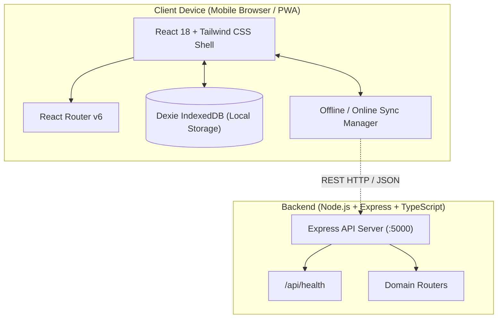

# KiranaSathi Architecture Overview

## 1. Project Goal
**KiranaSathi** (किराना साथी) is an offline-first, mobile-first inventory and reorder assistant designed specifically for small Indian kirana store owners. It addresses unstable network connectivity, fast-paced counter transactions, and bilingual usability requirements.

---

## 2. Architectural Pillars

### Pillar 1: Offline-First Reliability
- **Client Database:** Dexie.js (IndexedDB abstraction layer) stores products, stock levels, and transaction logs locally inside the shopkeeper's browser.
- **No Internet Blockers:** Daily operations (barcode scanning, stock adjustment, rapid billing) work with zero network latency and without an active internet connection.
- **Progressive Web App (PWA):** Installable on Android and iOS devices directly from the browser, with background caching of application assets.

### Pillar 2: Mobile-First Indian Shopkeeper UX
- **High-Contrast, Accessible Theme:** Trustworthy kirana green (`#15803D`), clean off-white background (`#F8FAF7`), and warm saffron accents (`#F59E0B`).
- **Large Touch Targets:** Minimum button heights of 48px to accommodate busy counters and one-handed thumb interaction.
- **Bilingual Interface:** English coupled with clear Devanagari Hindi labels (e.g. *स्टॉक*, *बिक्री*, *ऑर्डर*).

### Pillar 3: Modular Monorepo Architecture
- **NPM Workspaces:** Clean separation of concerns between `apps/frontend` and `apps/backend`.
- **Shared Standards:** Base TypeScript configurations and shared type definitions.

---

## 3. High-Level System Architecture



---

## 4. Directory Structure

```text
kiranaSathi/
├── apps/
│   ├── frontend/            # React 18 + Vite + Tailwind PWA
│   │   ├── public/icons/    # PWA icons and app logo
│   │   ├── src/
│   │   │   ├── components/  # Reusable UI (ui, layout, products)
│   │   │   ├── pages/       # Route pages (WelcomePage, NotFoundPage)
│   │   │   ├── features/    # Business modules (inventory, sales, reorder, assistant)
│   │   │   ├── db/          # Dexie.js database schema
│   │   │   ├── hooks/       # Custom React hooks (e.g. useNetworkStatus)
│   │   │   ├── i18n/        # Bilingual English/Hindi localization strings
│   │   │   ├── services/    # API communication services
│   │   │   ├── types/       # TypeScript type interfaces
│   │   │   ├── App.tsx      # Main application routing shell
│   │   │   └── main.tsx     # React DOM entrypoint
│   │   ├── vite.config.ts   # Vite + PWA + Vitest configuration
│   │   └── tailwind.config.ts
│   └── backend/             # Express + TypeScript API server
│       ├── src/
│       │   ├── routes/      # Express route controllers (/api/health, etc.)
│       │   ├── controllers/ # Request handlers
│       │   ├── services/    # Business and status services
│       │   ├── middleware/  # Error handler & 404 handler
│       │   ├── utils/       # Zod-validated environment config
│       │   ├── app.ts       # Express app setup and middleware
│       │   └── server.ts    # HTTP listener entrypoint
│       └── tests/           # Supertest API tests
├── docs/                    # Architecture, testing, and demo documentation
├── package.json             # Root monorepo workspace configuration
├── tsconfig.base.json       # Shared TypeScript compiler options
└── README.md                # Getting started and setup guide
```

---

## 5. Security & Environment Principles
- **No Secrets in Frontend:** The frontend only consumes variables prefixed with `VITE_` intended for public client consumption.
- **Environment Validation:** Backend environment variables are validated at boot-time with Zod (`apps/backend/src/utils/env.ts`).
- **Graceful Degradation:** When the backend server is unreachable, the frontend continues operating in client-only offline mode with visible feedback.
